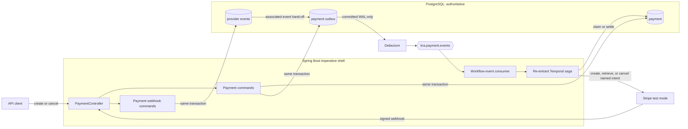
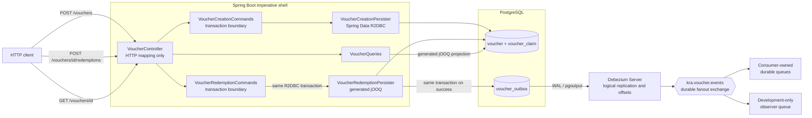

# Kotlin Reference Architecture

An executable Kotlin reference architecture for Functional Core, Imperative Shell (FCIS), Command Query Separation (CQS), PostgreSQL correctness, and event-driven processing. Voucher redemption and the Stripe-backed payment workflow demonstrate complementary business slices.

## Start here

The architecture section explains module ownership and the core/shell boundary. The feature-flow diagrams then show the two reference slices: concurrent voucher redemption and the re-entrant payment-request saga. Use [Local setup](#local-setup) to run the stack, and the design documents when you need the detailed correctness rules.

## Architecture

- `com.theok.kra.core.foundation` defines framework-free entity, aggregate, and persistence contracts.
- `com.theok.kra.core.voucher` contains independently testable Voucher rules, outcomes, and DTOs.
- `com.theok.kra.core.payment` contains independently testable payment rules, statuses, and DTOs.
- `voucher-adapter` owns `com.theok.kra.shell.voucher`: its controllers, commands, queries, persistence adapters, Liquibase migrations, and generated jOOQ table model.
- `payment-adapter` owns `com.theok.kra.shell.payment`: its HTTP and webhook commands, read projections, operation-specific persistence, Stripe integration, Temporal workflow activities, Liquibase migrations, and generated jOOQ table model.
- `platform:database` owns reusable R2DBC transaction participation and jOOQ JSON support.
- `platform:web` owns reusable WebFlux problem-response infrastructure.
- `app` is the Spring Boot deployment/composition unit and scans the `shell` package.

ArchUnit tests enforce that the functional core cannot depend on Spring, jOOQ, R2DBC, messaging, Temporal, or Jackson. CQS uses Spring Data R2DBC for command persistence and direct jOOQ projections for queries; both deliberately share PostgreSQL. Payment workflow state changes use short, operation-specific persistence transactions, while Stripe and Temporal calls remain outside those transactions. Successful state changes append their outbox records atomically for Debezium publication.

See [Voucher redemption design](docs/design/voucher-redemption.md) for the core/shell boundary and the PostgreSQL concurrency guarantees. See [Payment workflow design](docs/design/payment-workflow.md) for its lifecycle, cancellation, webhook-recovery, and event-delivery flows. The stable system, deployment, and module boundaries are available in the [Structurizr C4 workspace](docs/architecture/structurizr/README.md).

## Feature flows

### Payment workflow resilience

The Stripe-backed payment workflow is intentionally demo-only. It accepts only Stripe test-mode
secret keys and test-mode webhook deliveries; live API keys and `livemode=true` webhooks are
rejected. It is not a production payment integration.

`payment_request` owns commercial terms, idempotency, deadlines, cancellation requests, and saga
status. Its optional `payment` owns the realised Stripe lifecycle. PostgreSQL is authoritative:
outbox events, RabbitMQ deliveries, and Temporal signals are at-least-once wake-ups, never
authority for a Stripe side effect. A cancellation command records the request and its wake-up
event atomically. The re-entrant saga then reads durable request and payment state and either does
nothing, finalises locally when no Stripe intent exists, or reconciles the named Stripe intent.

Stripe calls occur between short database transactions. Before cancelling, the workflow durably claims the cancellation origin and uses a stable idempotency key for that payment and origin. If a cancellation response is lost, it retrieves Stripe before settling the local state rather than assuming the remote outcome. A recovered Stripe intent must match its expected ID, amount, currency, and `kra_payment_id` metadata.

There is one logical Temporal workflow ID per request. Signal-With-Start wakes a running execution
or starts a new one after closure; every execution reloads authoritative PostgreSQL state. It uses
the immutable request deadlines, Temporal retries and timers, and Continue-as-New rather than a
keep-alive window, reconciliation worker, or direct recovery path. Intent creation never
broad-searches Stripe or repeats a create after Stripe's idempotency window: recovery is limited to
a verified, payment-associated Stripe event.

Activity retry bounds are configurable through `payments.temporal`: a two-minute start-to-close
timeout, ten-minute schedule-to-close timeout, and three attempts are the defaults. Workflow
execution history is bounded with Continue-as-New without changing the logical workflow ID.



Payment state and verified provider events are the authority. Broker deliveries and Temporal signals
are wake-ups, not authority; durable commands and workflow activities apply guarded state changes.
See the [payment workflow design](docs/design/payment-workflow.md) for the complete lifecycle and
recovery policies.

### Voucher request, data, and event flow



Creation is an ordinary aggregate write. Redemption is deliberately different: its conditional capacity decrement, idempotency claim, and successful outbox insert execute in one PostgreSQL transaction. The event is published asynchronously only after that transaction commits. The optional observer queue exists only for local manual testing and is not a product consumer.

## Architecture choices and strengths

| Choice | Why it is used here | Result |
| --- | --- | --- |
| Kotlin functional core | `core` holds domain rules, outcomes, and contracts without framework dependencies. | Fast, framework-free unit tests and a clear boundary around business rules. |
| Functional core, imperative shell | Controllers, transactions, SQL, HTTP, and messaging stay in `shell`; `app` only composes them. | Infrastructure does not leak into the domain model. |
| Command-query separation | Commands define transactional state changes; queries use projections and never mutate. | Read paths are explicit and do not accidentally load or save aggregates. |
| Spring Data R2DBC for ordinary writes | Creation persists a valid aggregate through `R2dbcEntityTemplate` inside a declarative transaction. | Simple writes stay simple and non-blocking. |
| Generated jOOQ for reads and contention-sensitive writes | Queries use generated projections; redemption uses exact PostgreSQL affected-row semantics through `TransactionalJooqExecutor`. | SQL remains typed and visible where database correctness matters most. |
| No JPA/Hibernate or framework-owned CRUD layer | The core offers only small framework-free persistence contracts; feature adapters still own their operation-specific persistence implementations, mappings, and transaction boundaries. | Each persistence choice reflects the operation rather than an ORM unit of work or framework CRUD service. |
| Transactional outbox + Debezium | A successful voucher redemption or payment-request state change writes its feature outbox row in the same transaction; Debezium reads PostgreSQL logical replication and publishes it after commit. | No dual-write gap between the database decision and the event, with explicit at-least-once delivery semantics. |
| RabbitMQ fanout exchanges | Debezium publishes `VoucherRedeemed` to `kra.voucher.events` and payment workflow wake-ups to `kra.payment.events`; each consumer owns and binds its own durable queue. | Producers remain unaware of consumers, and consumers can be added independently while retaining persistent, broker-confirmed delivery. |
| Temporal request saga | One re-entrant, request-scoped workflow reloads authoritative PostgreSQL state after a Signal-With-Start wake-up and drives Stripe calls, deadlines, and reconciliation timers. | Provider uncertainty and transient timer failures remain recoverable without a separate reconciliation worker or a new broker delivery. |
| PostgreSQL as the concurrency authority | Constraints and conditional updates, not application locks, decide idempotency and remaining capacity. | Safe concurrent redemption across many application instances connected to one primary writer. |
| Executable architecture checks | ArchUnit, Testcontainers, and the HTTP-to-RabbitMQ smoke test prove the boundaries and flow. | The intended architecture is verified continuously rather than relying only on documentation. |

## Persistence and transaction policy

### Payment persistence and recovery

Payment-request acceptance records immutable commercial terms, initial lifecycle state, and a workflow wake-up in one transaction. Cancellation requests, associated verified webhook events, and terminal transitions likewise append their required outbox records with the corresponding durable state change.

Stripe create, retrieve, and cancellation calls occur outside those transactions. A durable claim names the one provider intent that may be reconciled, and stable idempotency keys protect provider operations. If the provider response or local follow-up is uncertain, the re-entrant Temporal saga reconciles from durable state; it never broad-searches Stripe or repeats intent creation after the provider's idempotency window.

### Voucher persistence

Voucher persistence intentionally uses two tools for two different jobs:

- `VoucherCreationCommands` creates a valid domain voucher, then delegates the ordinary insert to `VoucherCreationPersister`, which uses Spring Data R2DBC.
- `VoucherRedemptionCommands` defines the transactional write unit and delegates PostgreSQL-specific redemption SQL to `VoucherRedemptionPersister`: `INSERT ... ON CONFLICT DO NOTHING`, the conditional capacity decrement, final claim status, and conditional outbox insert.

Redemption must not load a voucher, decrement it in memory, and save it: that would not preserve capacity under concurrent requests. The jOOQ sequence keeps the affected-row decision and every related write in one transaction. The two command classes do not mix persistence styles; `TransactionalJooqExecutor` ensures that, if a command needs both Spring Data and jOOQ, they share the same Spring-managed R2DBC transaction.

### Transaction boundary

Public `open suspend` Spring command-service methods normally define declarative `@Transactional` boundaries. A Temporal activity or message consumer that sequences durable database work around remote I/O may instead use a narrow transaction exposed by its operation-specific persistence adapter. Those transactions contain database work only; Stripe, Temporal, RabbitMQ, and other remote calls happen before or after them. `R2dbcEntityTemplate` persists mapped aggregate rows and uses `@Version` where optimistic locking is appropriate. `TransactionalJooqExecutor` obtains the same transaction-bound R2DBC connection for jOOQ work, preventing accidental second connections.

The Boot-managed R2DBC pool uses bounded acquire, creation, and validation timeouts; two acquisition retries; remote `SELECT 1` validation; idle/lifetime eviction; and environment-overridable capacity settings. The R2DBC pool uses the configured idle timeout for eviction when no explicit interval is supplied.

`dbGenerateJooq` applies the Voucher and Payment adapter migrations, regenerates their jOOQ sources, and compiles those sources. It is intentionally database-dependent and is not part of the ordinary compile/test path.

## Local setup

1. Copy `.env.example` to `.env` and replace all password placeholders. Gradle loads this file automatically for `:app:bootRun` and the database-generation tasks; PostgreSQL is provided only by the Docker Compose `postgres` service.

   ```powershell
   Copy-Item .env.example .env
   ```
2. Start the complete local stack. Compose configures `wal_level=logical` and sizes `max_replication_slots` / `max_wal_senders` from `KRA_POSTGRES_MAX_REPLICATION_SLOTS` and `KRA_POSTGRES_MAX_WAL_SENDERS`; keep both values sufficient for the shared Debezium connector.

   ```powershell
   docker compose --env-file .env -f infrastructure/compose.yaml up -d
   ```

   Published infrastructure ports bind only to `127.0.0.1`; the services remain available to
   local tools but are not exposed on other network interfaces.

3. On a new PostgreSQL volume, Docker runs `infrastructure/postgres/init-kra.sh` through `/docker-entrypoint-initdb.d`. It invokes the bootstrap SQL to create the application database, roles, grants, and default privileges before PostgreSQL is marked healthy.

   Liquibase is intentionally organised as three clean baselines: voucher-owned tables in
   `voucher-adapter`, payment-owned tables in `payment-adapter`, and shared CDC state/publication
   in the app-composed infrastructure changelog. The feature adapters own their schema baselines;
   the app composes the shared CDC infrastructure after both feature schemas.

4. Run `./gradlew :platform-database:dbGenerateJooq`. This compatibility entry point verifies the generated jOOQ sources owned by both feature adapters.
5. Run `./gradlew test`. PostgreSQL integration tests use Testcontainers and skip when Docker is unavailable.
6. Run `./gradlew :app:bootRun`, then visit `/actuator/health`. The first application start applies the Liquibase migration before Debezium can publish events. Use the feature-specific manual smoke runners below when you need their optional profile or external integration.

The app uses `KRA_DB_APP_USER` / `KRA_DB_APP_PASSWORD`; Liquibase and jOOQ generation use `KRA_DB_MIGRATOR_USER` / `KRA_DB_MIGRATOR_PASSWORD`. Both use the configured R2DBC/JDBC URLs. No credentials are committed.

RabbitMQ, its one-shot topology initializer, Debezium, Temporal, and Temporal UI start with PostgreSQL. Temporal is shared workflow infrastructure; the Stripe-backed payment feature is enabled separately through Spring's `payments` profile. `rabbitmq-init` idempotently declares the durable `kra.voucher.events` and `kra.payment.events` fanout exchanges before Debezium starts. One Debezium Server `3.7.1.Final` connector loads `infrastructure/debezium/application.properties`, reads both `kra.voucher_outbox` and `kra.payment_outbox` through the Liquibase-managed `kra_outbox_publication`, and routes their common `aggregate_type` to the matching exchange. Compose supplies credentials and deployment-specific names. The connector uses the Compose-network `postgres` service, `kra_cdc`, `pgoutput`, and a PostgreSQL JDBC offset store accessed through the dedicated `kra_cdc_state` role. Liquibase pre-creates the offset table and grants that role only `SELECT`, `INSERT`, `UPDATE`, and `DELETE`; the connector's `offset.storage.jdbc.table.ddl=SELECT 1` deliberately prevents it from attempting DDL with that least-privilege role. Until a fresh stack's first application start creates that table, Debezium remains running and retries its offset-store connection rather than restart-looping. Its automatic publication creation is disabled and its replication slot is retained on shutdown. PostgreSQL and RabbitMQ are pinned to patch releases.

Debezium routes `VoucherRedeemed` and payment outbox events to their corresponding durable fanout exchanges as the existing JSON event payloads. Consumer services must declare durable queues and bind them before events are produced; this example provisions no product queues other than the payment workflow queue. The configured JSON header formatter emits AMQP header scalars as JSON values (for example, the `eventType` header is `"VoucherRedeemed"`); the body remains the unwrapped event JSON object. Delivery is at-least-once: a connector crash after RabbitMQ accepts an event and before its offset is committed can replay it, so consumers use the stable `eventId` for deduplication.

PostgreSQL retains WAL needed by an inactive logical replication slot. Monitor replication-slot lag and WAL disk usage, and remediate a stopped Debezium connector before retained WAL threatens database storage.

Run the complete shared-connector verification with `./gradlew :app:test --tests com.theok.kra.app.payment.PaymentDebeziumRabbitMqIntegrationTest --rerun-tasks`. It provisions PostgreSQL and RabbitMQ containers, emits voucher and payment events through one Debezium connector, verifies each exchange, and confirms connector restart recovery. The voucher-specific test additionally verifies fan-out to two durable queues.

## Build and verification

Kotlin sources and Gradle Kotlin scripts use Spotless with `ktfmt`. Apply formatting with:

```powershell
./gradlew spotlessApply
```

`spotlessCheck` is a prerequisite of every Gradle `test` and `check` task, so an unformatted change fails normal verification. Generated jOOQ sources are deliberately excluded: regenerate them instead of formatting or editing them manually.

Run the normal verification suite with:

```powershell
.\gradlew.bat test
```

GitHub Actions runs the same test suite for every push and pull request. The manual smoke tests are separate opt-in Gradle tasks: `manualVoucherSmoke` needs Docker and a configured `.env`; `manualPaymentSmoke` additionally needs a Stripe test-mode `STRIPE_API_KEY` and the Stripe CLI on `PATH`.

Application integration tests are organised by scenario and share lifecycle, infrastructure, JSON-payload, and database helpers under `com.theok.kra.app.testsupport`. Reusable fixtures are named for the infrastructure they provide, not for a particular feature. Testcontainers tests wait for the service state that their application needs, not merely for an open port.

## Manual voucher smoke test

Run the complete smoke test with:

```powershell
./gradlew manualVoucherSmoke
```

The task starts the local infrastructure and application, then checks readiness, creates and redeems
a voucher, and verifies its capacity. Its Dockerized HTTP client reaches the host application through
`host.docker.internal`. The feature's HTTP test and Compose asset are co-located under
`app/src/test/manual/voucher`. To run that HTTP client against an application you have already
started, use `./gradlew manualVoucherHttpSmoke`.

For interactive observation too, start the `manual-test` profile. Its one-shot
`rabbitmq-manual-observer-init` service declares the development-only
`kra.voucher.events.inspect` queue, retaining at most 1,000 events and discarding the oldest when
full. RabbitMQ Management at `http://localhost:15672` shows the redemption event there; use a
requeue option when previewing a message if you do not want to consume it.

## Manual Stripe test-mode check

The payment feature is test-mode-only. Set `STRIPE_API_KEY` in the untracked `.env` file to a Stripe
test-mode secret key and install the [Stripe CLI](https://docs.stripe.com/stripe-cli). Then the complete
live test is one command:

```powershell
./gradlew manualPaymentSmoke
```

The task starts the local infrastructure, Stripe webhook forwarding, and a payment-profile
application; it captures the listener-specific webhook secret without writing it to `.env`, runs the
Compose HTTP test, then stops the listener and application. Pass
`-PkeepManualPaymentSmokeRunning` when you want to inspect the running application after the test.
To run only the Dockerized HTTP client against an already-running payment application and Stripe CLI
listener, use `./gradlew manualPaymentHttpSmoke`.

The app's payment endpoint identifiers are only suitable for this trusted demo; they are not customer
authorization credentials.

## Ownership and licence

Kotlin Reference Architecture is proprietary software developed for private engineering, learning, and demonstration purposes. **All rights reserved.** Access to this repository does not grant permission to copy, redistribute, modify, or reuse the source. See [LICENSE](LICENSE) for the governing notice.
