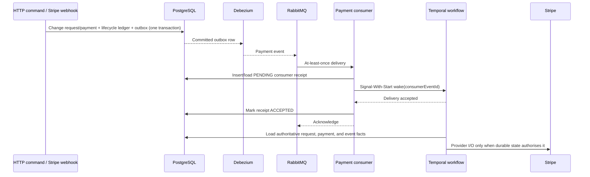
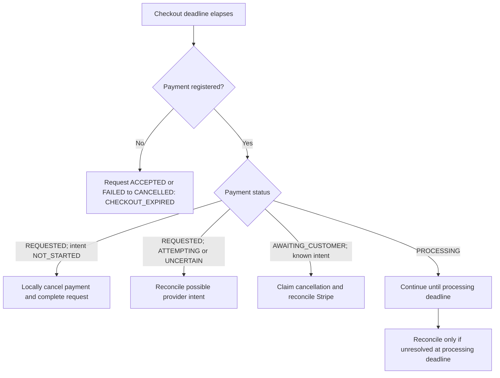
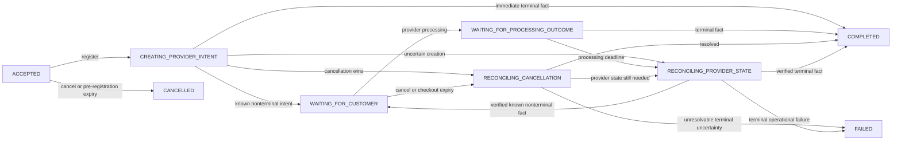

# Re-entrant payment request saga

`payment_request` is the authoritative commercial request and saga record. It owns the owner,
idempotency key, purchase reference, amount, currency, immutable checkout and processing deadlines,
cancellation request, and request status. `payment` is optional until the first Temporal activity
registers it; it owns realised provider state, intent-creation claims, provider cancellation
outcomes, terminal reason, and reconciliation state.

PostgreSQL is authoritative. RabbitMQ messages and Temporal signals are at-least-once wake-ups;
they do not by themselves authorize a Stripe action or a transition.



## Workflow and delivery

The sole logical workflow ID is `payment-request-{paymentRequestId}`. Temporal uses
`ALLOW_DUPLICATE` reuse and `USE_EXISTING` conflict policy, so a completed execution may receive a
later execution backed by an associated Stripe event with the same logical ID.

```text
accepted request / cancellation / verified Stripe event / authorised retry
  → transactional payment outbox
  → Debezium → RabbitMQ
  → PENDING consumer receipt
  → Signal-With-Start(wake(consumerEventId))
  → Temporal acceptance
  → ACCEPTED receipt → broker acknowledgement
```

`PaymentSagaWorkflow` has one signal, `wake(consumerEventId)`. Signal handlers only enqueue IDs.
The main loop drains them and activities load the durable receipt, event type, verified Stripe
event, request, and optional payment. The dispatcher is infrastructure-only. `PaymentSucceeded` and
`PaymentCancelled` notification events still receive durable `SKIPPED` receipts, but never wake a
workflow. Before a terminal workflow return, the loop drains any IDs already enqueued by signals;
Temporal's normal completion conflict handling then retries a completion task raced by a newer
signal rather than silently discarding it.

The workflow has no terminal keep-alive or arbitrary run timeout. It uses persisted absolute
deadlines, activity retry/backoff, reconciliation timers, and Continue-as-New. Pending wake-ups and
original deadlines are retained across continuation. Unresolved reconciliation stays active; no
database reconciliation worker or direct post-closure recovery path exists.

An exhausted nonterminal wake-up or timer activity does not close the workflow. It first attempts
to classify the outcome durably as reconciliation-required; if that write is temporarily
unavailable too, Temporal retains an active reconciliation timer and retries from authoritative
state without requiring another RabbitMQ wake-up. If that retry finds an accepted request without a
payment, ordinary initialisation performs the first safe registration. A terminal-outcome
inconsistency remains exceptional and follows its operational failure path.

The reconciliation timer reloads authoritative state rather than merely polling Stripe. A durable
customer cancellation resumes the normal cancellation reconciler, including another safe attempt
with its origin-specific stable idempotency key after a transient Stripe failure. An uncertain
creation with no recorded intent may instead reuse one associated, unapplied verified provider
event: it retrieves only that event's named intent, revalidates its identity and commercial terms,
and attaches it without another broker delivery or intent create. The provider event is marked
applied in the same transaction as its durable status fact. If attachment succeeds but its first
status refresh fails, the event remains unapplied; a later reconciliation finds that event by the
now-known intent ID and performs the same atomic application.

The first execution starts from its Signal-With-Start wake-up. A Continue-as-New execution reloads
authoritative PostgreSQL state to restore its timers after pending wake-ups have been drained.

`consumerEventId` is the UUID generated by the transactional outbox and used as the durable
RabbitMQ consumer-receipt key. `stripeEventId` is Stripe's `evt_…` webhook identifier. PostgreSQL
keeps provider-neutral persistence names such as `payment_provider_event` and `provider_event_id`;
the current application adapter interprets those events only as Stripe events.

## Lifecycle and deadlines

At acceptance one timestamp establishes immutable deadlines:

```text
checkoutDeadlineAt   = createdAt + 30 minutes
processingDeadlineAt = createdAt + 60 minutes
```

They are never extended by Stripe unavailability, restart, payment registration, or
Continue-as-New. Checkout expiry before registration transitions an `ACCEPTED` or payment-less
`FAILED` request to `CANCELLED` with `CHECKOUT_EXPIRED`, writes the request ledger, and creates
neither a payment nor an intent. After registration, expiry cancels locally only when intent
creation is `NOT_STARTED`; attempted, uncertain, and known provider creation use the normal
provider reconciliation safeguards.
Processing may continue only to the immutable processing deadline, after which the saga reconciles
rather than silently abandoning the provider outcome.



Checkout expiry never cancels a `PROCESSING` payment. Customer cancellation remains request-owned
and is reconciled independently of those immutable deadlines.

`PaymentRequestStatus.COMPLETED` is permitted only when its payment is `SUCCEEDED` or `CANCELLED`
and `reconciliationRequired` is false. `FAILED` is an operational, intervention-required saga
failure; it never changes the realised payment result and can also occur before a payment is
registered. A non-retryable operational failure records the bounded reason and an
`OPERATIONAL_FAILURE` request-ledger entry in the same transaction. An authorised retry writes its
own wake-up: it performs first registration when no payment exists, otherwise it re-enters from the
realised payment state. A requested payment returns to creation or reconciliation, while a settled
payment returns to `COMPLETED` without another provider operation.



The diagram shows ordinary progress and reconciliation exits only. Exceptional re-entry is derived
from the durable request and payment state, rather than being a free-form transition:

| Durable state when re-entered | Result |
| --- | --- |
| `ACCEPTED` or payment-less `FAILED` | First safe registration, or direct `CANCELLED` if cancellation/expiry already won |
| `FAILED` with requested payment | `CREATING_PROVIDER_INTENT` or `RECONCILING_PROVIDER_STATE`, according to the creation claim |
| `FAILED` with known nonterminal payment | `WAITING_FOR_CUSTOMER`, `WAITING_FOR_PROCESSING_OUTCOME`, or cancellation reconciliation |
| `FAILED` with settled payment and no reconciliation hold | `COMPLETED` without provider I/O |
| `COMPLETED` with a new relevant cancellation or verified provider fact | Re-enter the applicable reconciliation path; only durable facts authorise it |

A cancellation requested after registration transitions the request to
`RECONCILING_CANCELLATION` atomically with the request-owned cancellation record and wake-up. The
saga then applies the existing local-finalisation or provider-cancellation rules. A cancellation
before registration transitions an `ACCEPTED` or payment-less `FAILED` request directly to
`CANCELLED` and creates neither a payment nor a Stripe intent.

If a verified webhook proves an unrecorded intent while the request is already
`RECONCILING_CANCELLATION`, the intent is attached but the request remains in cancellation
reconciliation. The saga then cancels or otherwise reconciles that known intent; it never returns
to checkout merely because the late create result was recovered.

For a known intent with no pending cancellation, a commercially verified Stripe response that still
maps to `AWAITING_CUSTOMER` resolves ordinary provider-state reconciliation. The transaction clears
the reconciliation flag and reason, returns the request to `WAITING_FOR_CUSTOMER`, and records
`RECONCILIATION_RESOLVED`; normal immutable-deadline handling then resumes. This never resolves
unrecorded-creation uncertainty, cancellation reconciliation, or an undetermined terminal cause.

A `CANCELLED` payment with `CAUSE_UNDETERMINED` remains reconciling while Stripe retrieval or local
persistence is transiently uncertain. The reconciliation timer retries those recoverable failures.
Once a Stripe fact is verified, a corroborating provider cancellation fact resolves the cause. If a
verified fact still cannot establish the cause (or no intent exists to verify), a request-first
transaction locks the request, reloads the payment, and escalates only when it is still
`CANCELLED`, still `CAUSE_UNDETERMINED`, and still reconciliation-required. It then transitions the
request to `FAILED` for operational intervention and ends the active workflow; an authorised retry
may later re-enter from the same durable payment state.

A concurrent webhook resolution takes the same request-first lock. If it has already cleared the
payment reconciliation state and moved the request to `COMPLETED`, the stale escalation observes
the resolved payment and returns the current durable state without writing `FAILED`. The permitted
`COMPLETED → FAILED` transition is therefore reserved for an independently classified operational
failure, never a stale terminal-cancellation escalation.

Checkout setup is unavailable while either cancellation or provider-state reconciliation is active.
In particular, `GET /setup` never exposes a stored Stripe client secret for a request in
`RECONCILING_PROVIDER_STATE`.

Both `payment_lifecycle_event` and `payment_request_lifecycle_event` are append-only. Every genuine
request status transition has one request lifecycle record in the same transaction. Request
cancellations, reconciliation required/resolved transitions, and operational retries are also
recorded as immutable facts. Repeated attempts to mark an already-reconciling payment leave its
original reason and ledger record unchanged.

## Security

Customer endpoints are under `/payment-requests/**`; ownership is resolved from the request,
not the realised payment. Stripe webhook ingress at
`POST /payment-requests/stripe/webhook` remains public because it uses Stripe signature
verification.

`POST /internal/payment-requests/{paymentRequestId}/retries` is an operational endpoint. It
requires a valid JWT with `payments:retry` scope (`SCOPE_payments:retry` in Spring Security).
Missing or invalid credentials return `401`; an authenticated principal without that scope returns
`403`. Trusted-demo access never satisfies this scope. A successful command records the JWT subject
and reason, writes a transactional retry outbox event, and leaves recovery to the normal re-entrant
saga.

## Transactional rules

Any transaction that touches both request and payment locks request first, then payment. It applies
guarded payment changes, guarded request changes, both lifecycle entries, and required outbox events
before one commit. Stripe calls occur outside the transaction. A Stripe intent claim is immutable
and commits before the remote call; cancellation or checkout expiry winning before that claim
prevents creation. If cancellation wins after the claim but Stripe returns an intent, the original
claim still attaches that known intent ID without overwriting request cancellation state; the saga
then reconciles cancellation against that intent. Creation becomes `UNCERTAIN` only when the
returned provider response cannot be safely verified or durably attached. A reconciliation or
operational-failure decision locks the request before it reads the optional payment, so concurrent
registration is serialised before the request-only versus payment-backed outcome is classified.

A successful Stripe create response has no pre-existing durable provider ID to compare. It must
instead carry a nonblank PaymentIntent ID and match the payment's amount, currency, and
`kra_payment_id` metadata before its ID or encrypted client secret is persisted or exposed. Every
later Stripe status response, whether from ordinary refresh, cancellation refresh, or verified
webhook recovery, must also match that durable intent ID and the same commercial terms before it
can change payment state. A signed webhook that cannot be associated with a local payment remains
a durable audit-only provider event and does not wake the saga.

Only Stripe's explicit customer-action statuses (`requires_payment_method`,
`requires_confirmation`, and `requires_action`) map to `AWAITING_CUSTOMER`. `requires_capture` and
unknown future statuses remain provider-state reconciliation until the application has an explicit
safe policy; they never clear a reconciliation hold by default.
