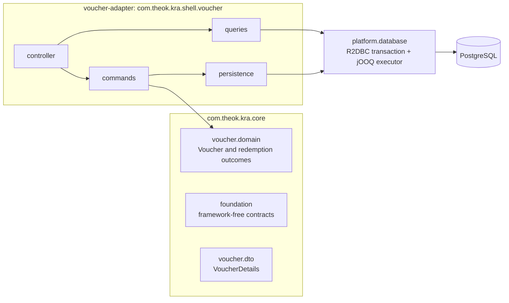
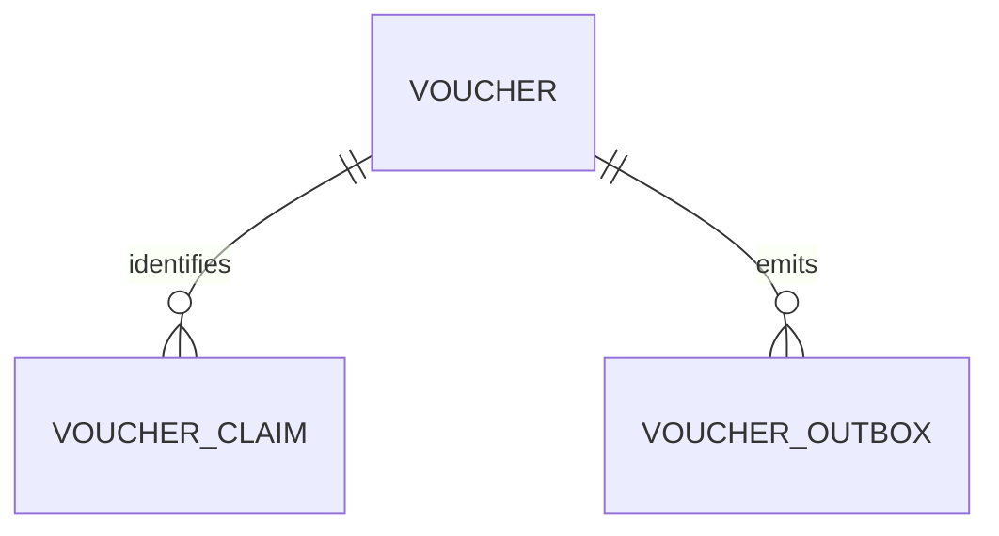
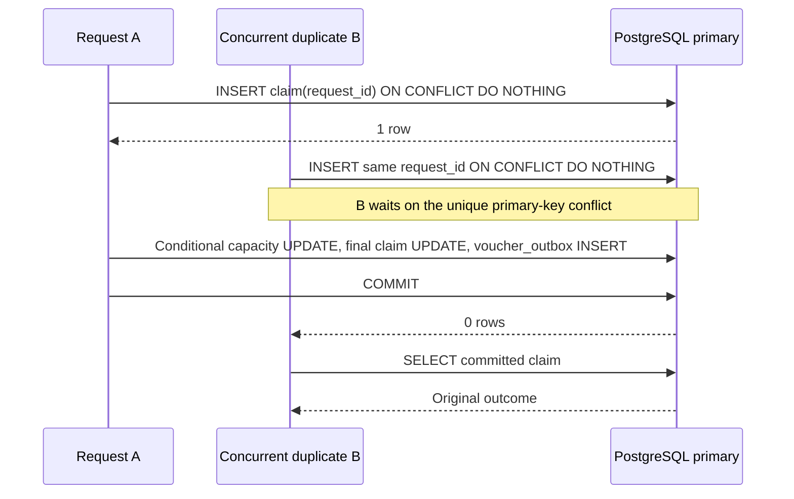

# Voucher redemption design

The Voucher example is deliberately small: creation, voucher details, and idempotent redemption. It demonstrates FCIS, CQS, PostgreSQL concurrency, and a transactional outbox without adding an aggregate-save framework, distributed locking, or a separate idempotency store.

## Boundaries

`core` contains rules and data that are independently testable. The `voucher-adapter` shell performs HTTP mapping, transaction coordination, SQL, persistence, schema migration, and generated table ownership. The boot application only composes and scans `shell`; `platform.database` supplies the transaction manager and `TransactionalJooqExecutor`.

## Durable data model

The [voucher Liquibase baseline](../../voucher/adapter/src/main/resources/db/changelog/voucher-schema.sql) is the column-level schema authority. This small model keeps the state that decides a redemption separate from its recorded request outcome and its asynchronously published event.

| Table | Durable responsibility | Important integrity rule |
| --- | --- | --- |
| `voucher` | Aggregate capacity state. | `id` is the primary key; `initial_capacity` is positive and `remaining` is always between zero and that initial capacity. |
| `voucher_claim` | Idempotency record and stable outcome for a redemption request. | `request_id` is the primary key, so a duplicate request receives the recorded result; checks allow only `PENDING`, `SUCCEEDED`, or a recognised rejection reason. `voucher_id` is a logical reference used to detect key reuse for a different voucher. |
| `voucher_outbox` | Append-only `VoucherRedeemed` integration event published by Debezium after commit. | `event_id` is the primary key; checks constrain the event and aggregate types to this feature's redemption event. |

## Persistence choices

`VoucherCreationCommands` creates a valid `Voucher` and delegates the ordinary insert to `VoucherCreationPersister`, which uses Spring Data R2DBC. `VoucherRedemptionCommands` defines the transaction boundary and delegates the PostgreSQL-specific workflow to `VoucherRedemptionPersister`, which uses generated jOOQ types because redemption depends on affected-row semantics:

1. Insert `voucher_claim` as `PENDING` with `ON CONFLICT (request_id) DO NOTHING`.
2. For a duplicate, load and return the recorded claim, or return an idempotency conflict if its voucher differs.
3. Decrement capacity with `UPDATE voucher SET remaining = remaining - 1 WHERE id = :id AND remaining > 0`.
4. Finalise the claim as succeeded or rejected, then insert `VoucherRedeemed` into `voucher_outbox` only for success.

Every redemption step runs in the public `@Transactional` command method through the transaction-bound R2DBC connection. An unexpected error rolls back the claim, decrement, and event together. `voucher_outbox` is append-only and has the shared Debezium envelope (`event_id`, `aggregate_id`, `aggregate_type`, event type, payload, and occurrence time). The one Debezium Server connector reads both feature-owned outbox tables through PostgreSQL logical replication and routes this table's `aggregate_type=voucher` rows to the durable `kra.voucher.events` fanout exchange. Its offsets live in PostgreSQL through a separate, least-privilege `kra_cdc_state` connection.

RabbitMQ consumers own their durable queues and bindings; they must bind before an event is produced. Broker-confirmed persistent delivery is at-least-once rather than exactly-once: a crash between broker acceptance and an offset commit can replay an event. The stable outbox `eventId` is the future consumer deduplication key. While Debezium is offline, its retained PostgreSQL replication slot can retain WAL, so operational monitoring must cover slot lag and WAL storage.

## Why concurrent redemption is safe

PostgreSQL has one authoritative primary writer, while many application instances may concurrently write to it. This design depends on PostgreSQL constraints, row locking, and `READ COMMITTED` statement re-evaluation rather than on a single application writer or an application lock.

For different request IDs racing for the final capacity unit, PostgreSQL serialises updates to the voucher row. After waiting, a competing conditional update re-evaluates `remaining > 0`; it affects zero rows once the first transaction has consumed the final unit. Thus exactly one request succeeds, capacity never becomes negative, and only that successful request creates an outbox event.

This guarantee applies to many application writers connected to one PostgreSQL primary. Independently writable, asynchronously replicated multi-primary databases need a different consistency design and are outside this example.

## Executable guarantees

[VoucherRedemptionIntegrationTest](../../app/src/test/kotlin/com/theok/kra/app/voucher/VoucherRedemptionIntegrationTest.kt) proves final-unit contention, concurrent duplicates, idempotency-key conflicts, stable rejected outcomes, transaction rollback, and database constraints. [VoucherTest](../../voucher/domain/src/test/kotlin/com/theok/kra/core/voucher/domain/VoucherTest.kt) proves the framework-free creation invariant.
